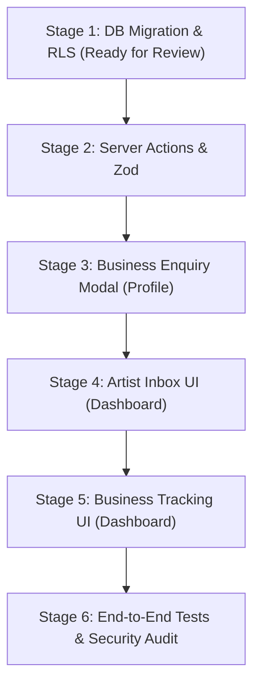

# Phase 5.1: Secure Booking Enquiry System — Implementation Plan & Architecture Specification

> **DOCUMENT STATUS:** ARCHITECTURAL SPECIFICATION & PLANNING (APPROVED IN PRINCIPLE WITH CORRECTIONS)  
> **CURRENT STAGE:** STAGE 1 SPECIFICATION COMPLETE (AWAITING OWNER APPROVAL TO EXECUTE MIGRATION)  
> **TARGET MILESTONE:** PHASE 5.1 (BOOKING ENQUIRIES — DISCOVERY TO NEGOTIATION)  
> **SCOPE BOUNDARY:** INQUIRIES ONLY. ZERO PAYMENTS, ZERO CONTRACTUAL OBLIGATIONS, ZERO CALENDAR AUTO-BLOCKING.

---

## 1. Executive Summary & Purpose

The Artist Network is currently a testing version deployed on Netlify (`https://artist-net-v1.netlify.app`), with an active local development environment (`localhost:3000`). Having completed Phase 1 through Phase 4.7 (Artist Discovery, Directory, Profiles, Portfolios, Admin Moderation, Verification, and Private Artist Calendars), the platform now requires a secure, non-binding mechanism for verified business accounts to initiate formal gig enquiries with published artists.

### 1.1 Core Problem Statement
Currently, business accounts visiting an artist profile (`/artists/[slug]`) see a callout: *"Login as Client to check prices!"*. On the business dashboard (`/dashboard/restaurant`), outgoing enquiries and weekend line-ups are static UI demonstrations (`mockSentEnquiries`, `mockLineup`). There is no operational database pipeline for a business to communicate event requirements, verify mutual interest, or negotiate dates with an artist.

### 1.2 Phase 5.1 Objective
Design and specify a secure, end-to-end Booking Enquiry System allowing:
1. **Authenticated businesses** to submit structured gig enquiries to **published artists**.
2. **Artists** to review enquiries in their private dashboard, inspect event details and budgets, and respond (`interested`, `declined`, or `info_requested`).
3. **Businesses** to provide a single structured clarification response when an artist requests more information, or withdraw pending submissions.
4. **Both parties** to track the enquiry lifecycle in real time with an immutable, append-only history trail.

> [!IMPORTANT]
> **Enquiry ≠ Confirmed Booking.**  
> A Phase 5.1 enquiry is strictly an expression of interest and exploratory communication. The artist expressing interest (`interested`) **does NOT create a confirmed booking, contract, payment obligation, or calendar event**. Date locking, escrow, and confirmed contracts are explicitly deferred to Phase 5.2+.

---

## 2. Review of Existing Architecture & Database Verifications

Before specifying the SQL schema, the existing live database catalog and migrations were thoroughly inspected:

| Component | Verified Location | Verification Findings & Architecture Compliance |
|---|---|---|
| **Artist Foreign Key** | `public.artist_profiles(id)` | `artist_profiles.id` is a primary key that references `public.profiles(id) ON DELETE CASCADE`. Foreign key in enquiries points to `public.artist_profiles(id)` ensuring target must be a valid artist profile. |
| **Business Foreign Key** | `public.profiles(id)` | Business accounts exist in `public.profiles` (`role = 'business'`) with extended metadata in `public.business_profiles`. Foreign key in enquiries points to `public.profiles(id)`. |
| **Artist Eligibility** | `public.artist_profiles.profile_status` | Status CHECK: `('draft', 'published', 'suspended', 'pending_review', 'rejected')`. Only `published` artists can receive enquiries. Suspended artists are completely frozen. |
| **Role Verification** | `public.profiles.role` | Strictly verified inside DB functions via `SELECT role FROM public.profiles WHERE id = auth.uid()`. Never trusts client-supplied `user_metadata`. |
| **Admin Authorization** | `public.is_admin()` | Existing `SECURITY DEFINER` function with `SET search_path = ''`. Authenticated grant only. Used for admin read policies. |
| **Security Definer Functions** | Postgres Catalog | All RPCs explicitly define `SECURITY DEFINER` and `SET search_path = ''` to prevent search-path hijacking attacks. |
| **Client Privilege Revocation** | Postgres Privilege Engine | Direct table `INSERT`, `UPDATE`, `DELETE` are completely revoked from `PUBLIC`, `anon`, and `authenticated`. All mutations must use authorized RPCs. |
| **Artist Calendar Schema** | `public.artist_calendar_events` | Contains `platform_inquiry_id UUID DEFAULT NULL` protected by immutable triggers. **Zero calendar changes occur in Phase 5.1**. Calendar events are NOT auto-created. |
| **Zero External Paid Dependencies** | Architecture Invariant | Rate limiting, flood prevention, and spam controls run 100% inside PostgreSQL. Zero external dependencies (no Upstash, Redis, Resend, or SMTP). |

---

## 3. Workflow Architecture & Lifecycle State Machine

### 3.1 Non-Binding Status Semantics

To prevent any legal, financial, or operational ambiguity, the non-binding status label **`interested`** replaces any notion of "accepted" or "confirmed".

- **`submitted`**: Initial state. Business submitted event details; awaiting artist review.
- **`seen`**: Artist intentionally opened/expanded the enquiry details card. Fetching records does **not** trigger this.
- **`info_requested`**: Artist reviewed details and requested clarification (e.g. stage dimensions, sound rider, exact timings).
- **`clarified`**: Business submitted the single clarification response addressing the artist's questions.
- **`interested`**: **(Non-binding terminal state)**. Artist expressed interest in the event. Does not block dates or create contracts. Offline or Phase 5.2 negotiations follow.
- **`declined`**: **(Terminal state)**. Artist is unavailable or declined the enquiry.
- **`withdrawn`**: **(Terminal state)**. Business withdrew the enquiry before conclusion.

### 3.2 Complete Transition Matrix

```
                          ┌──────────────┐
                          │  submitted   │
                          └──────┬───────┘
          ┌──────────────────────┼──────────────────────┬──────────────────────┐
          │ (artist seen)        │ (artist interested)  │ (artist decline)     │ (business withdraw)
          ▼                      │                      │                      ▼
    ┌──────────┐                 │                      │                ┌───────────┐
    │   seen   │                 │                      │                │ withdrawn │ (Terminal)
    └─────┬────┘                 │                      │                └───────────┘
          ├──────────────────────┤                      │                      ▲
          │                      │                      │                      │
          │ (request info)       │                      │                      │
          ▼                      │                      │                      │
   ┌─────────────┐               │                      │                      │
   │info_request.│               │                      │                      │
   └──────┬──────┘               │                      │                      │
          ├──────────────────────┼──────────────────────┤                      │
          │ (business clarify)   │ (artist decline)     │ (business withdraw)  │
          ▼                      │                      └──────────────────────┘
   ┌─────────────┐               │
   │  clarified  │               │
   └──────┬──────┘               │
          ├──────────────────────┘
          │                      │
          ▼                      ▼
   ┌─────────────┐        ┌───────────┐
   │ interested  │        │ declined  │ (Terminal)
   └─────────────┘        └───────────┘
     (Terminal)
```

| Source State | Trigger / Action | Authorized Actor | Target State | Required Payload / Constraints |
|---|---|---|---|---|
| *None* | `submit_booking_enquiry` RPC | Business | `submitted` | Future IST date, event type, requirements, optional budget, message. |
| `submitted` | `respond_to_booking_enquiry('seen')` | Artist | `seen` | Triggered explicitly when artist expands enquiry drawer. |
| `submitted` | `respond_to_booking_enquiry('interested')` | Artist | `interested` | Optional response note. Non-binding interest expressed. |
| `submitted` | `respond_to_booking_enquiry('decline')` | Artist | `declined` | Optional decline reason. Terminal state. |
| `submitted` | `respond_to_booking_enquiry('request_info')` | Artist | `info_requested` | Mandatory question / clarification text (`>= 5 chars`). |
| `submitted` | `withdraw_booking_enquiry` RPC | Business | `withdrawn` | Permitted while in `submitted` state. Terminal state. |
| `seen` | `respond_to_booking_enquiry('interested')` | Artist | `interested` | Optional response note. |
| `seen` | `respond_to_booking_enquiry('decline')` | Artist | `declined` | Optional decline reason. Terminal state. |
| `seen` | `respond_to_booking_enquiry('request_info')` | Artist | `info_requested` | Mandatory question text (`>= 5 chars`). |
| `seen` | `withdraw_booking_enquiry` RPC | Business | `withdrawn` | Permitted while in `seen` state (before artist formal response). |
| `info_requested` | `clarify_booking_enquiry` RPC | Business | `clarified` | Mandatory clarification answer (`>= 5 chars`, max 2,000 chars). |
| `info_requested` | `respond_to_booking_enquiry('decline')` | Artist | `declined` | Artist decides not to proceed. Terminal state. |
| `info_requested` | `withdraw_booking_enquiry` RPC | Business | `withdrawn` | Business decides not to clarify and closes enquiry. |
| `clarified` | `respond_to_booking_enquiry('interested')` | Artist | `interested` | Artist is satisfied with clarification. Terminal state. |
| `clarified` | `respond_to_booking_enquiry('decline')` | Artist | `declined` | Artist declines after reading clarification. Terminal state. |

---

## 4. Database Architecture & Concurrency Control

### 4.1 Schema Definition: `public.booking_enquiries`

```sql
CREATE TABLE IF NOT EXISTS public.booking_enquiries (
  id                    UUID          PRIMARY KEY DEFAULT gen_random_uuid(),

  -- Foreign Keys
  business_id           UUID          NOT NULL REFERENCES public.profiles(id) ON DELETE CASCADE,
  artist_id             UUID          NOT NULL REFERENCES public.artist_profiles(id) ON DELETE CASCADE,

  -- Status Machine
  status                TEXT          NOT NULL DEFAULT 'submitted'
    CHECK (status IN ('submitted', 'seen', 'info_requested', 'clarified', 'interested', 'declined', 'withdrawn')),

  -- Event Specifications (No CURRENT_DATE check; date validated in RPC)
  event_date            DATE          NOT NULL,
  event_type            TEXT          NOT NULL
    CHECK (event_type IN ('wedding', 'corporate', 'restaurant', 'festival', 'private', 'concert', 'other')),
  event_location        TEXT          CHECK (event_location IS NULL OR char_length(event_location) <= 255),
  requirements          TEXT          CHECK (requirements IS NULL OR char_length(requirements) <= 2000),
  indicative_budget     NUMERIC(12,2) CHECK (indicative_budget IS NULL OR indicative_budget >= 0),
  business_message      TEXT          CHECK (business_message IS NULL OR char_length(business_message) <= 2000),

  -- Communication Details
  artist_response       TEXT          CHECK (artist_response IS NULL OR char_length(artist_response) <= 2000),
  business_clarification TEXT         CHECK (business_clarification IS NULL OR char_length(business_clarification) <= 2000),

  -- Timestamps for Lifecycle Audit
  seen_at               TIMESTAMPTZ,
  responded_at          TIMESTAMPTZ,
  clarified_at          TIMESTAMPTZ,
  created_at            TIMESTAMPTZ   NOT NULL DEFAULT now(),
  updated_at            TIMESTAMPTZ   NOT NULL DEFAULT now()
);
```

### 4.2 Append-Only History Table: `public.booking_enquiry_events`

To provide an understandable, tamper-proof history without unnecessary complexity, every lifecycle transition automatically logs an immutable event record:

```sql
CREATE TABLE IF NOT EXISTS public.booking_enquiry_events (
  id            UUID        PRIMARY KEY DEFAULT gen_random_uuid(),
  enquiry_id    UUID        NOT NULL REFERENCES public.booking_enquiries(id) ON DELETE CASCADE,
  actor_id      UUID        NOT NULL REFERENCES public.profiles(id),
  actor_role    TEXT        NOT NULL CHECK (actor_role IN ('business', 'artist', 'admin')),
  action        TEXT        NOT NULL CHECK (action IN ('submitted', 'seen', 'info_requested', 'clarified', 'interested', 'declined', 'withdrawn')),
  notes         TEXT        CHECK (notes IS NULL OR char_length(notes) <= 2000),
  created_at    TIMESTAMPTZ NOT NULL DEFAULT now()
);

CREATE INDEX IF NOT EXISTS idx_booking_enquiry_events_enquiry 
  ON public.booking_enquiry_events (enquiry_id, created_at ASC);
```

### 4.3 Atomic Concurrency Control & Rate Limiting

To guarantee that the **3-active-enquiry limit per pair** and **submission velocity limits** cannot be bypassed by concurrent browser tabs or automated scripts, `submit_booking_enquiry` acquires **transaction-level PostgreSQL advisory locks**:

```sql
-- 1. Pair Lock: Serializes concurrent submissions between the exact same business and artist
PERFORM pg_advisory_xact_lock(hashtext('enquiry_pair:' || v_business_id::text || ':' || p_artist_id::text)::bigint);

-- 2. Business Rate Lock: Serializes concurrent submissions for the business account
PERFORM pg_advisory_xact_lock(hashtext('enquiry_biz:' || v_business_id::text)::bigint);
```

Under these locks, the RPC executes three atomic safety checks:
1. **Pair Limit:** `COUNT(*) WHERE business_id = v_business_id AND artist_id = p_artist_id AND status NOT IN ('declined', 'withdrawn') < 3`.
2. **Platform-wide Active Limit:** `COUNT(*) WHERE business_id = v_business_id AND status NOT IN ('declined', 'withdrawn') < 10`.
3. **Hourly Velocity Limit:** `COUNT(*) WHERE business_id = v_business_id AND created_at > (now() - INTERVAL '1 hour') < 5`.

### 4.4 Date & Time Zone Policy
- Table-level `CHECK (event_date >= CURRENT_DATE)` is **intentionally omitted** to prevent schema restore failures and allow historical records to remain valid across time.
- Date validation is performed inside `submit_booking_enquiry` using **Indian Standard Time (`Asia/Kolkata` = UTC+5:30)**:
  ```sql
  v_min_date := (now() AT TIME ZONE 'Asia/Kolkata')::DATE + INTERVAL '1 day';
  IF p_event_date < v_min_date THEN
    RAISE EXCEPTION 'Event date must be at least tomorrow (IST)' USING ERRCODE = '23514';
  END IF;
  ```
- In the dashboard UI, enquiries whose `event_date < CURRENT_DATE` are visually flagged as *"Past Event"* while preserving their full historical status.

---

## 5. Security & Privacy Safeguards

1. **Direct Write Access Revocation:**
   - Table `public.booking_enquiries`: `REVOKE INSERT, UPDATE, DELETE FROM PUBLIC, anon, authenticated`.
   - Table `public.booking_enquiry_events`: `REVOKE INSERT, UPDATE, DELETE FROM PUBLIC, anon, authenticated`.
   - All mutations execute through trusted `SECURITY DEFINER` RPCs with `SET search_path = ''`.
2. **Row Level Security Policies:**
   - Businesses can `SELECT` only their own sent enquiries (`business_id = auth.uid()`).
   - Artists can `SELECT` only their own received enquiries (`artist_id = auth.uid()`).
   - Admins can `SELECT` all enquiries via `public.is_admin()`.
   - Anonymous visitors have **zero access**.
3. **Sensitive Data Protection:**
   - Business email and phone numbers are not stored on enquiry rows or exposed via API.
   - Public visitors browsing `/artists/[slug]` cannot inspect enquiries.
4. **Calendar Isolation:**
   - Enquiries do **not** interact with `public.artist_calendar_events`.
   - Calendar events are neither blocked nor created.

---

## 6. UI / UX Design & Dashboard Specifications

### 6.1 Public Artist Profile (`/artists/[slug]`)
- **Anonymous Visitor:** Sees callout *"Login as Client to Check Rates & Send Enquiry"* pointing to `/login?redirectTo=/artists/[slug]`.
- **Artist / Admin:** "Send Booking Enquiry" button is hidden or disabled with an informative message.
- **Business Account:** Displays purple button **"Send Booking Enquiry"**.
- **Modal Component (`SendEnquiryModal.tsx`):**
  - Event Date (picker restricted to `min = tomorrow (IST)`).
  - Event Type dropdown.
  - Venue / Location (optional).
  - Indicative Budget (optional, clearly labeled in **₹ INR**).
  - Sound & Tech Requirements (optional, max 2,000 chars).
  - Business Message (optional, max 2,000 chars).
  - **Disclaimer Banner:** *"Submitting this enquiry is non-binding. It does not confirm a booking, block dates, or require payment. The artist will review your request and reply directly."*

### 6.2 Artist Dashboard Inbox (`/dashboard/artist`)
- New tab: **"Enquiries"** with an amber unread badge (`status = 'submitted'`).
- **Read-Safety Invariant:** Merely loading or viewing the dashboard does **not** mark enquiries as seen.
- Expanding an enquiry drawer triggers `respond_to_booking_enquiry('seen')`.
- Actions:
  - **Express Interest** (emerald button): Sets status to `interested`.
  - **Request Information** (purple outlined button): Prompts for question and sets status to `info_requested`.
  - **Decline** (rose outlined button): Prompts for optional reason and sets status to `declined`.
- If business provided clarification (`status = 'clarified'`), shows a purple highlight box with `business_clarification`.

### 6.3 Business Dashboard Sent Enquiries (`/dashboard/restaurant`)
- Replaces `mockSentEnquiries` with live Supabase query.
- Displays enquiry cards with status indicators:
  - `Submitted` (amber): Awaiting artist review. Shows **Withdraw Enquiry** button.
  - `Seen` (blue): Artist has reviewed the enquiry.
  - `Clarification Requested` (purple): Artist asked a question. Form displayed: *"Provide Clarification"* (textarea) + *"Withdraw"*.
  - `Clarified` (blue): Awaiting artist response to clarification.
  - `Artist Interested` (emerald): **"Artist Interested (Non-binding)"** with a label *"The artist is interested in this gig! Connect directly to discuss contract terms and scheduling."*
  - `Declined` (gray): Artist is unavailable.
  - `Past Event` badge: If `event_date < today`, clearly marked as past without corrupting status.

---

## 7. Stage-by-Stage Implementation Roadmap



### Stage 1: Database Migration & RLS (Current Focus)
- **File:** `supabase/migrations/20261117_booking_enquiries.sql`
- **Database Objects:**
  - Table `public.booking_enquiries`
  - Table `public.booking_enquiry_events`
  - 5 performance and filtering indexes
  - 6 RLS policies
  - 4 `SECURITY DEFINER` RPCs:
    1. `submit_booking_enquiry`
    2. `respond_to_booking_enquiry`
    3. `clarify_booking_enquiry`
    4. `withdraw_booking_enquiry`
- **Status:** File prepared and syntax-checked. **Execution pending owner approval.**

### Stage 2: Server Actions & Validation Layer
- **Files to Add/Modify:** `app/actions/enquiries.ts`, `lib/enquiries/schemas.ts`, `lib/enquiries/types.ts`.
- **Scope:** Fail-closed server actions verifying roles via `public.profiles`. Zod validation for IST dates and length limits.

### Stage 3: Business Enquiry Submission UI
- **Files to Add/Modify:** `app/components/SendEnquiryModal.tsx`, `app/artists/[slug]/page.tsx`.
- **Scope:** Role-gated modal, non-binding notice, client validation, INR currency formatting.

### Stage 4: Artist Enquiry Inbox & Response UI
- **Files to Add/Modify:** `app/dashboard/artist/page.tsx`, `app/components/ArtistEnquiryInbox.tsx`.
- **Scope:** Enquiries tab, unread counter, explicit seen trigger, Accept (Interested) / Clarify / Decline controls.

### Stage 5: Business Enquiry Tracking UI
- **Files to Add/Modify:** `app/dashboard/restaurant/page.tsx`, `app/components/BusinessEnquiryTracker.tsx`.
- **Scope:** Replace mock data, status chips, clarification reply form, withdrawal button, past-event badges.

### Stage 6: End-to-End Testing & Security Verification
- **Files to Add/Modify:** `scripts/test-phase-5-1-enquiries.ts`.
- **Scope:** Automated verification across both test accounts (`artist.test`, `business.test`); concurrency and rate limit verification; clean teardown.
