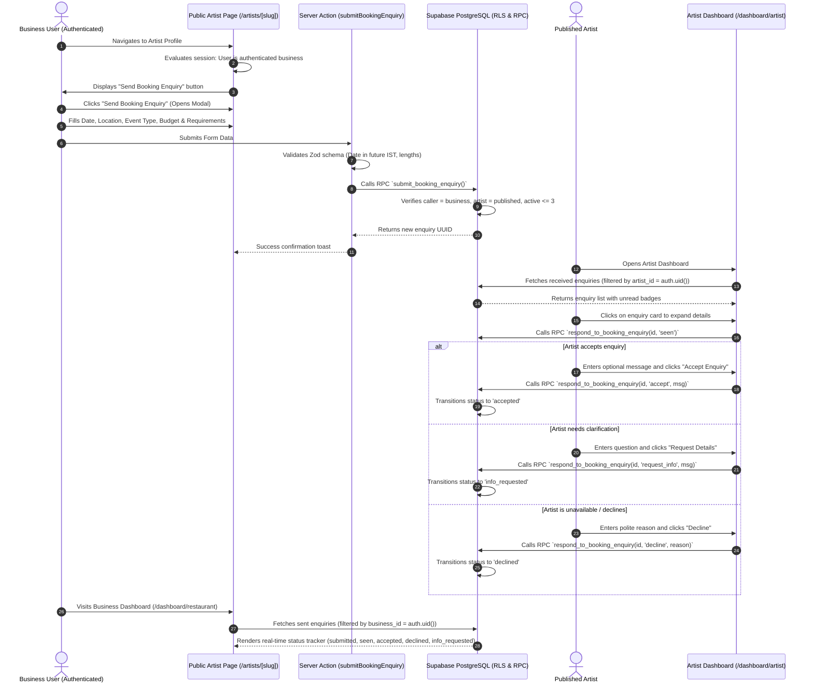
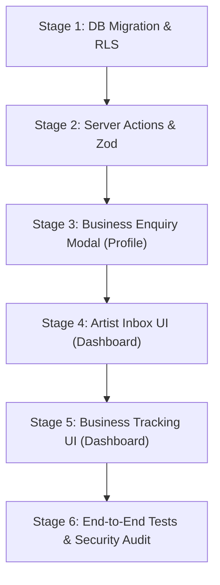

# Phase 5.1: Secure Booking Enquiry System — Implementation Plan & Architecture Specification

> **DOCUMENT STATUS:** ARCHITECTURAL SPECIFICATION & PLANNING ONLY  
> **CURRENT STAGE:** PRE-IMPLEMENTATION REVIEW (AWAITING OWNER APPROVAL)  
> **TARGET MILESTONE:** PHASE 5.1 (BOOKING ENQUIRIES — DISCOVERY TO NEGOTIATION)  
> **SCOPE BOUNDARY:** INQUIRIES ONLY. ZERO PAYMENTS, ZERO AUTOMATIC BOOKINGS, ZERO CALENDAR AUTO-BLOCKING.

---

## 1. Executive Summary & Purpose

The Artist Network is currently a testing version deployed on Netlify (`https://artist-net-v1.netlify.app`), with an active local development environment (`localhost:3000`). Having completed Phase 1 through Phase 4.7 (Artist Discovery, Directory, Profiles, Portfolios, Admin Moderation, Verification, and Private Artist Calendars), the platform now requires a secure, non-binding mechanism for verified business accounts to initiate formal gig enquiries with published artists.

### 1.1 Core Problem Statement
Currently, business accounts visiting an artist profile (`/artists/[slug]`) see a callout: *"Login as Client to check prices!"*. On the business dashboard (`/dashboard/restaurant`), outgoing enquiries and weekend line-ups are static UI demonstrations (`mockSentEnquiries`, `mockLineup`). There is no operational database pipeline for a business to communicate event requirements, verify mutual interest, or negotiate dates with an artist.

### 1.2 Phase 5.1 Objective
Design and specify a secure, end-to-end Booking Enquiry System allowing:
1. **Authenticated businesses** to submit structured gig enquiries to **published artists**.
2. **Artists** to review enquiries in their private dashboard, inspect event details and budgets, and respond (`accepted`, `declined`, or `info_requested`).
3. **Businesses** to monitor enquiry lifecycles in real time and withdraw pending submissions if plans change.

> [!IMPORTANT]
> **Enquiry ≠ Confirmed Booking.**  
> A Phase 5.1 enquiry is strictly an expression of interest and initial communication of terms. It carries **no legal obligation, no financial commitment, no escrow, and no automatic calendar reservations**. Date locking and confirmed contracts are explicitly deferred to Phase 5.2+.

---

## 2. Review of Existing Architecture & Reusable Assets

A rigorous review of the existing repository reveals substantial infrastructure that can be leveraged without architectural rework:

| Existing Asset | Location | Relevance to Phase 5.1 |
|---|---|---|
| **Role Guard (`requireBusiness`)** | `lib/auth/business.ts` | Server-side authorization verifying `profiles.role === 'business'` directly via `supabase.auth.getUser()` + DB query. Redirects unauthorized users. Reusable for business submission actions and dashboard views. |
| **Role Guard (`requireArtist`)** | `lib/auth/artist.ts` | Server-side authorization verifying `profiles.role === 'artist'`. Reusable for artist inbox and response server actions. |
| **Session Helper (`getCurrentUser`)** | `app/auth/actions.ts` | Extracts authenticated user profile server-side; already passed to `<Navbar />` across public pages. Reusable for conditionally rendering the "Send Enquiry" CTA on public artist profiles. |
| **Artist Profiles DB** | `public.artist_profiles` | Contains `profile_status` (`'draft'`, `'published'`, `'suspended'`, `'pending_review'`, `'rejected'`), `is_verified`, `starting_price`, and `pricing_unit`. Invariant check: only `'published'` artists can receive enquiries. |
| **Business Profiles DB** | `public.business_profiles` | Contains `business_name`, `contact_name`. Linked 1:1 with `public.profiles(id)`. |
| **Artist Calendar Schema** | `public.artist_calendar_events` (`20261112_artist_calendar.sql`) | Already contains the column `platform_inquiry_id UUID DEFAULT NULL` (protected by immutable triggers). This placeholder ensures future confirmed bookings can link to enquiries without altering the calendar schema. |
| **Admin Moderation System** | `public.admin_audit_logs`, `lib/auth/admin.ts` | Admins have global audit logging and moderation tools. Can view all enquiries via `public.is_admin()` for dispute resolution or support without modifying data. |
| **Next.js 16 Server Architecture** | `export const instant = false`, Turbopack | Complies with Next.js 16 conventions (`proxy.ts`, request-time connection handlers, fail-closed server actions). |

---

## 3. Workflow Architecture & Lifecycle State Machine

### 3.1 Step-by-Step User Journey



### 3.2 State Machine & Transition Rules

The table below outlines all valid lifecycle states and transitions. **Any transition not explicitly permitted in this matrix is rejected at the database level.**

| Initial State | Trigger / Action | Actor | Target State | Notes / Constraints |
|---|---|---|---|---|
| *None* | `submit_booking_enquiry` RPC | Business | `submitted` | Default state upon creation. Artist profile must be `published`. Event date must be in future. |
| `submitted` | Open / view details | Artist | `seen` | Automatic or manual state transition when artist expands the record in their dashboard. |
| `submitted` | Withdraw enquiry | Business | `withdrawn` | Permitted **only** while in `submitted` state (before artist marks it seen/responds). |
| `submitted` | Accept directly | Artist | `accepted` | Artist agrees to date, budget, and requirements. |
| `submitted` | Decline directly | Artist | `declined` | Artist unavailable or requirements not suitable. Terminal state for this enquiry. |
| `submitted` | Request information | Artist | `info_requested` | Artist requests rider clarification, time adjustments, or fee adjustments. |
| `seen` | Accept | Artist | `accepted` | Artist accepts terms. |
| `seen` | Decline | Artist | `declined` | Artist declines terms. Terminal state. |
| `seen` | Request information | Artist | `info_requested` | Artist requests further details. |
| `info_requested` | Accept | Artist | `accepted` | Artist accepts following offline/in-app resolution. |
| `info_requested` | Decline | Artist | `declined` | Negotiation concludes without agreement. Terminal state. |
| `accepted` | *Terminal (Phase 5.1)* | — | `accepted` | Enquiries do not auto-convert to calendar entries in Phase 5.1. |
| `declined` | *Terminal* | — | `declined` | No further transitions permitted. |
| `withdrawn` | *Terminal* | — | `withdrawn` | Business cancelled; no further transitions permitted. |

---

## 4. Database Architecture & Supabase Schema Specification

### 4.1 Schema Definition (`public.booking_enquiries`)

```sql
-- Migration: 20261117_booking_enquiries.sql
BEGIN;

CREATE TABLE IF NOT EXISTS public.booking_enquiries (
  id                UUID        PRIMARY KEY DEFAULT gen_random_uuid(),

  -- Foreign Keys
  business_id       UUID        NOT NULL REFERENCES public.profiles(id) ON DELETE CASCADE,
  artist_id         UUID        NOT NULL REFERENCES public.profiles(id) ON DELETE CASCADE,

  -- Status Machine
  status            TEXT        NOT NULL DEFAULT 'submitted'
    CHECK (status IN ('submitted', 'seen', 'accepted', 'declined', 'info_requested', 'withdrawn')),

  -- Event Specifications
  event_date        DATE        NOT NULL,
  event_type        TEXT        NOT NULL
    CHECK (event_type IN ('wedding', 'corporate', 'restaurant', 'festival', 'private', 'concert', 'other')),
  event_location    TEXT,
  requirements      TEXT        CHECK (requirements IS NULL OR char_length(requirements) <= 2000),
  indicative_budget NUMERIC(12, 2) CHECK (indicative_budget IS NULL OR indicative_budget >= 0),
  business_message  TEXT        CHECK (business_message IS NULL OR char_length(business_message) <= 2000),

  -- Artist Response
  artist_response   TEXT        CHECK (artist_response IS NULL OR char_length(artist_response) <= 2000),

  -- Timestamps
  created_at        TIMESTAMPTZ NOT NULL DEFAULT now(),
  updated_at        TIMESTAMPTZ NOT NULL DEFAULT now(),

  -- Database-level future date guard
  CONSTRAINT chk_enquiry_event_date_future CHECK (event_date >= CURRENT_DATE)
);
```

### 4.2 Indexes & Performance Optimization
```sql
-- Fast lookup of business sent enquiries sorted by recency
CREATE INDEX IF NOT EXISTS idx_booking_enquiries_business 
  ON public.booking_enquiries (business_id, created_at DESC);

-- Fast lookup of artist received inbox sorted by recency
CREATE INDEX IF NOT EXISTS idx_booking_enquiries_artist 
  ON public.booking_enquiries (artist_id, created_at DESC);

-- Rapid filtering of enquiries by status
CREATE INDEX IF NOT EXISTS idx_booking_enquiries_status 
  ON public.booking_enquiries (status);

-- Filter active enquiries for spam/duplicate checking
CREATE INDEX IF NOT EXISTS idx_booking_enquiries_active_pair
  ON public.booking_enquiries (business_id, artist_id)
  WHERE status NOT IN ('declined', 'withdrawn');
```

### 4.3 Row Level Security (RLS) Policies

All direct client table mutations (`INSERT`, `UPDATE`, `DELETE`) are **REVOKED** from `PUBLIC`, `anon`, and `authenticated`. All mutations must occur via `SECURITY DEFINER` RPCs to enforce business logic, rate limits, and status constraints.

```sql
ALTER TABLE public.booking_enquiries ENABLE ROW LEVEL SECURITY;

-- 1. Revoke client direct write grants
REVOKE INSERT, UPDATE, DELETE ON public.booking_enquiries FROM PUBLIC;
REVOKE INSERT, UPDATE, DELETE ON public.booking_enquiries FROM anon;
REVOKE INSERT, UPDATE, DELETE ON public.booking_enquiries FROM authenticated;

-- 2. Business SELECT: Can view only enquiries they submitted
CREATE POLICY "Business can view own sent enquiries"
  ON public.booking_enquiries
  FOR SELECT
  TO authenticated
  USING (business_id = auth.uid());

-- 3. Artist SELECT: Can view only enquiries sent to them
CREATE POLICY "Artist can view own received enquiries"
  ON public.booking_enquiries
  FOR SELECT
  TO authenticated
  USING (artist_id = auth.uid());

-- 4. Admin SELECT: Can view all enquiries for support and compliance
CREATE POLICY "Admins can view all enquiries"
  ON public.booking_enquiries
  FOR SELECT
  TO authenticated
  USING (public.is_admin());
```

### 4.4 Stored Procedures / RPCs

#### 4.4.1 `submit_booking_enquiry`
Atomic creation of booking enquiries with safety guards:
- Caller identity must have `role = 'business'` in `public.profiles`.
- Target artist must have `profile_status = 'published'` in `public.artist_profiles`.
- Target artist cannot be the caller (`business_id <> artist_id`).
- Event date must be at least tomorrow in Indian Standard Time (`Asia/Kolkata`).
- Prevents spam: Maximum of 3 active (non-declined, non-withdrawn) enquiries from the same business to the same artist.

```sql
CREATE OR REPLACE FUNCTION public.submit_booking_enquiry(
  p_artist_id         UUID,
  p_event_date        DATE,
  p_event_type        TEXT,
  p_event_location    TEXT    DEFAULT NULL,
  p_requirements      TEXT    DEFAULT NULL,
  p_indicative_budget NUMERIC DEFAULT NULL,
  p_business_message  TEXT    DEFAULT NULL
)
RETURNS UUID
LANGUAGE plpgsql
SECURITY DEFINER
SET search_path = ''
AS $$
DECLARE
  v_business_id    UUID;
  v_business_role  TEXT;
  v_artist_status  TEXT;
  v_active_count   INTEGER;
  v_enquiry_id     UUID;
  v_min_date       DATE;
BEGIN
  -- 1. Authenticated session check
  v_business_id := auth.uid();
  IF v_business_id IS NULL THEN
    RAISE EXCEPTION 'Authentication required' USING ERRCODE = '42501';
  END IF;

  -- 2. Verify business role from profiles
  SELECT role INTO v_business_role FROM public.profiles WHERE id = v_business_id;
  IF v_business_role IS DISTINCT FROM 'business' THEN
    RAISE EXCEPTION 'Only business accounts can submit booking enquiries' USING ERRCODE = '42501';
  END IF;

  -- 3. Prevent self-enquiry
  IF v_business_id = p_artist_id THEN
    RAISE EXCEPTION 'Cannot submit booking enquiry to your own account' USING ERRCODE = '23514';
  END IF;

  -- 4. Verify target artist is published
  SELECT profile_status INTO v_artist_status FROM public.artist_profiles WHERE id = p_artist_id;
  IF v_artist_status IS NULL THEN
    RAISE EXCEPTION 'Artist profile not found' USING ERRCODE = 'P0002';
  END IF;
  IF v_artist_status <> 'published' THEN
    RAISE EXCEPTION 'Enquiries can only be sent to published artists' USING ERRCODE = '23514';
  END IF;

  -- 5. Validate event date is strictly in the future (IST)
  v_min_date := (now() AT TIME ZONE 'Asia/Kolkata')::DATE + INTERVAL '1 day';
  IF p_event_date < v_min_date THEN
    RAISE EXCEPTION 'Event date must be at least tomorrow (IST)' USING ERRCODE = '23514';
  END IF;

  -- 6. Rate limit / duplicate check: max 3 active enquiries per business-artist pair
  SELECT COUNT(*) INTO v_active_count
  FROM public.booking_enquiries
  WHERE business_id = v_business_id
    AND artist_id   = p_artist_id
    AND status NOT IN ('declined', 'withdrawn');

  IF v_active_count >= 3 THEN
    RAISE EXCEPTION 'Limit reached: You have 3 active enquiries with this artist. Please wait for a response.' USING ERRCODE = '23514';
  END IF;

  -- 7. Insert record
  INSERT INTO public.booking_enquiries (
    business_id, artist_id, status, event_date, event_type,
    event_location, requirements, indicative_budget, business_message
  ) VALUES (
    v_business_id, p_artist_id, 'submitted', p_event_date, p_event_type,
    p_event_location, p_requirements, p_indicative_budget, p_business_message
  )
  RETURNING id INTO v_enquiry_id;

  RETURN v_enquiry_id;
END;
$$;
```

#### 4.4.2 `respond_to_booking_enquiry`
Enforces the artist state machine:
- Caller identity must have `role = 'artist'` in `public.profiles`.
- Target enquiry must belong to caller (`artist_id = auth.uid()`).
- Employs `FOR UPDATE` row locking to prevent concurrent state corruption.
- Restricts actions to `'seen'`, `'accept'`, `'decline'`, or `'request_info'`.

```sql
CREATE OR REPLACE FUNCTION public.respond_to_booking_enquiry(
  p_enquiry_id      UUID,
  p_action          TEXT,
  p_artist_response TEXT DEFAULT NULL
)
RETURNS VOID
LANGUAGE plpgsql
SECURITY DEFINER
SET search_path = ''
AS $$
DECLARE
  v_artist_id      UUID;
  v_artist_role    TEXT;
  v_current_status TEXT;
  v_new_status     TEXT;
BEGIN
  v_artist_id := auth.uid();
  IF v_artist_id IS NULL THEN
    RAISE EXCEPTION 'Authentication required' USING ERRCODE = '42501';
  END IF;

  SELECT role INTO v_artist_role FROM public.profiles WHERE id = v_artist_id;
  IF v_artist_role IS DISTINCT FROM 'artist' THEN
    RAISE EXCEPTION 'Only artists can respond to booking enquiries' USING ERRCODE = '42501';
  END IF;

  SELECT status INTO v_current_status
  FROM public.booking_enquiries
  WHERE id = p_enquiry_id AND artist_id = v_artist_id
  FOR UPDATE;

  IF v_current_status IS NULL THEN
    RAISE EXCEPTION 'Enquiry not found or access denied' USING ERRCODE = 'P0002';
  END IF;

  CASE p_action
    WHEN 'seen' THEN
      IF v_current_status NOT IN ('submitted') THEN
        RETURN; -- Idempotent if already viewed or beyond
      END IF;
      v_new_status := 'seen';
    WHEN 'accept' THEN
      IF v_current_status NOT IN ('submitted', 'seen', 'info_requested') THEN
        RAISE EXCEPTION 'Cannot accept an enquiry in status: %', v_current_status USING ERRCODE = '23514';
      END IF;
      v_new_status := 'accepted';
    WHEN 'decline' THEN
      IF v_current_status NOT IN ('submitted', 'seen', 'info_requested') THEN
        RAISE EXCEPTION 'Cannot decline an enquiry in status: %', v_current_status USING ERRCODE = '23514';
      END IF;
      v_new_status := 'declined';
    WHEN 'request_info' THEN
      IF v_current_status NOT IN ('submitted', 'seen') THEN
        RAISE EXCEPTION 'Cannot request info for enquiry in status: %', v_current_status USING ERRCODE = '23514';
      END IF;
      v_new_status := 'info_requested';
    ELSE
      RAISE EXCEPTION 'Invalid action: %', p_action USING ERRCODE = '23514';
  END CASE;

  UPDATE public.booking_enquiries
  SET status = v_new_status,
      artist_response = COALESCE(p_artist_response, artist_response),
      updated_at = now()
  WHERE id = p_enquiry_id AND artist_id = v_artist_id;
END;
$$;
```

#### 4.4.3 `withdraw_booking_enquiry`
Allows a business to cancel an enquiry if the artist has not yet responded or viewed it:

```sql
CREATE OR REPLACE FUNCTION public.withdraw_booking_enquiry(
  p_enquiry_id UUID
)
RETURNS VOID
LANGUAGE plpgsql
SECURITY DEFINER
SET search_path = ''
AS $$
DECLARE
  v_business_id    UUID;
  v_business_role  TEXT;
  v_current_status TEXT;
BEGIN
  v_business_id := auth.uid();
  IF v_business_id IS NULL THEN
    RAISE EXCEPTION 'Authentication required' USING ERRCODE = '42501';
  END IF;

  SELECT role INTO v_business_role FROM public.profiles WHERE id = v_business_id;
  IF v_business_role IS DISTINCT FROM 'business' THEN
    RAISE EXCEPTION 'Only businesses can withdraw enquiries' USING ERRCODE = '42501';
  END IF;

  SELECT status INTO v_current_status
  FROM public.booking_enquiries
  WHERE id = p_enquiry_id AND business_id = v_business_id
  FOR UPDATE;

  IF v_current_status IS NULL THEN
    RAISE EXCEPTION 'Enquiry not found or access denied' USING ERRCODE = 'P0002';
  END IF;

  IF v_current_status <> 'submitted' THEN
    RAISE EXCEPTION 'Enquiry can only be withdrawn before the artist responds (status: %)', v_current_status USING ERRCODE = '23514';
  END IF;

  UPDATE public.booking_enquiries
  SET status = 'withdrawn', updated_at = now()
  WHERE id = p_enquiry_id AND business_id = v_business_id;
END;
$$;

COMMIT;
```

---

## 5. Calendar Integration Strategy & Non-Blocking Invariant

### 5.1 Strict Isolation from Artist Calendar
The private artist calendar (`public.artist_calendar_events`) is operational and verified. In Phase 5.1:
- **Zero Automatic Date Blocks:** An enquiry in `submitted`, `seen`, `info_requested`, or `accepted` status **must not** generate an `artist_calendar_events` record or block dates on the artist's calendar.
- **Why?** An enquiry is an unconfirmed proposal. Auto-blocking dates on mere enquiry receipt would allow malicious business accounts to trigger denial-of-service on an artist's availability by flooding them with enquiries.
- **Preserved Schema:** The existing column `platform_inquiry_id UUID DEFAULT NULL` in `public.artist_calendar_events` remains untouched.
- **Future Integration (Phase 5.2+):** When a confirmed booking flow with explicit contract terms is implemented, the system will provide an artist action: *"Convert Accepted Enquiry to Confirmed Calendar Booking"*, which will create a calendar event referencing `platform_inquiry_id` and mark the date as busy.

---

## 6. UI / UX Design & Component Layouts

### 6.1 Public Artist Profile (`/artists/[slug]`)
1. **Call-to-Action Adaptation:**
   - **Anonymous Visitor:** Sees *"Login as Client to Check Rates & Send Enquiry"* pointing to `/login?redirectTo=/artists/[slug]`.
   - **Artist / Admin:** The "Send Enquiry" button is hidden or disabled with a helpful note (*"Enquiries can only be sent from Business accounts"*).
   - **Business Account:** A prominent purple CTA button: **"Send Booking Enquiry"** positioned next to social links and within the pricing banner.
2. **Modal Component (`SendEnquiryModal.tsx`):**
   - Clean, lightweight dialog with backdrop blur.
   - **Fields:**
     - Event Date (HTML `<input type="date">` restricted to `min={tomorrowIST}`).
     - Event Type dropdown (`Wedding`, `Corporate`, `Restaurant / Lounge`, `Private Party`, `Festival`, `Concert`, `Other`).
     - Venue / Event Location (City, Area, or specific venue name).
     - Indicative Budget (₹, optional number).
     - Requirements & Sound Needs (PA system provided? Acoustic or full band? Max 2,000 characters).
     - Business Message / Notes (e.g. proposed set times, theme).
   - **Non-Binding Notice:** Prominent banner:
     > *"Submitting this enquiry does not confirm a booking or guarantee artist availability. The artist will review your details and respond directly."*
   - Immediate feedback: loading spinner during submission, friendly error callouts, and clean success dialog.

### 6.2 Artist Dashboard Inbox (`/dashboard/artist`)
1. **Inbox Tab Integration:**
   - Add a dedicated **"Enquiries"** tab alongside "Overview" and "Portfolio Media".
   - Shows badge with unread enquiry count (count where `status = 'submitted'`).
2. **Enquiry Card Design:**
   - Header: Business Name, Event Date, Event Type, Indicative Budget.
   - Status Badge: `New` (amber), `Seen` (blue), `Accepted` (emerald), `Declined` (gray), `Info Requested` (purple).
   - Expandable Drawer: Shows full message, venue location, audio requirements, and submission timestamp.
   - Action Bar:
     - Button: **Accept Enquiry** (emerald).
     - Button: **Request Information** (purple outline, opens message input).
     - Button: **Decline** (rose outline, prompts for polite rejection reason).
3. **Empty State:**
   - Clean illustration with copy: *"No booking enquiries yet. Once businesses discover your profile in the directory, incoming gig requests will appear here."*

### 6.3 Business Dashboard Sent Enquiries (`/dashboard/restaurant`)
1. **Replace Mockup Tab:**
   - Replace `mockSentEnquiries` with live Supabase query data.
2. **Live Enquiry Tracker:**
   - Table / Card view showing: Artist Stage Name, Category, Event Date, Budget, Current Status.
   - Status indicators with clear explanatory tooltips.
   - Artist's response message (if provided).
   - Action: **Withdraw Enquiry** button (active only if `status === 'submitted'`).
3. **Empty State:**
   - *"You haven't sent any booking enquiries yet. Explore published talent in the Artist Directory to connect with performers."* with a CTA button to `/artists`.

---

## 7. Role & Permission Security Matrix

| User Role | Submit Enquiry | View Sent Enquiries | View Received Enquiries | Update Status | Withdraw Enquiry | Admin Moderation |
|---|:---:|:---:|:---:|:---:|:---:|:---:|
| **Anonymous** | ❌ (Denied) | ❌ (Denied) | ❌ (Denied) | ❌ (Denied) | ❌ (Denied) | ❌ (Denied) |
| **Artist** | ❌ (Denied) | ❌ (Denied) | ✅ (Own received only) | ✅ (`seen`, `accept`, `decline`, `request_info`) | ❌ (Denied) | ❌ (Denied) |
| **Business** | ✅ (To published artists) | ✅ (Own sent only) | ❌ (Denied) | ❌ (Denied) | ✅ (Only while `submitted`) | ❌ (Denied) |
| **Admin** | ❌ (Denied) | ❌ (Denied) | ❌ (Denied) | ❌ (Denied) | ❌ (Denied) | ✅ (Read-only SELECT) |

---

## 8. Security, Privacy & Abuse Defense Plan

1. **Defense Against Identity Spoofing:**
   - `submit_booking_enquiry` reads `v_business_id := auth.uid()` from the verified Supabase JWT session.
   - Role is queried from `public.profiles WHERE id = auth.uid()`. Client cannot forge `business_id` or pretend to be another business.
2. **Defense Against Harassment & Rate Limiting:**
   - Database constraint: A business can have at most **3 active enquiries** (`status NOT IN ('declined', 'withdrawn')`) with a single artist at any time.
   - Minimum character constraints and maximum character caps (`char_length <= 2000`) on all text inputs.
   - Server-side validation via Zod rejects malformed payloads before database interaction.
3. **Privacy of Business Contact Details:**
   - Business email and phone number are **not** exposed in the public artist profile or to third parties.
   - Enquiries are private communication between the authenticated business owner and the artist.
   - Public visitors cannot read any row in `public.booking_enquiries`.
4. **Time Zone & Scheduling Invariants:**
   - Event dates are strictly validated in Indian Standard Time (`Asia/Kolkata` = UTC+5:30).
   - Historical dates are blocked both at the database level (`event_date >= CURRENT_DATE`) and in server-side action validation.

---

## 9. Six-Stage Implementation Roadmap



### Stage 1: Database Schema & RLS Policies
- **Files to Add:** `supabase/migrations/20261117_booking_enquiries.sql`
- **Database Changes:** Create table `public.booking_enquiries`, indexes, RLS policies, trigger `set_booking_enquiry_updated_at`, RPCs `submit_booking_enquiry`, `respond_to_booking_enquiry`, `withdraw_booking_enquiry`.
- **Security Risks:** Incorrect RLS could leak business contact details or allow cross-tenant reading.
- **Verification:** Run SQL syntax checks; verify grants in Supabase catalog; confirm `PUBLIC` has zero write permissions.
- **Acceptance Criteria:** Table created; RLS enabled; RPCs executable only by `authenticated`.

### Stage 2: Server Actions & Validation Layer
- **Files to Add/Modify:** `app/actions/enquiries.ts`, `lib/enquiries/schemas.ts`, `lib/enquiries/types.ts`
- **Database Changes:** None.
- **Security Risks:** Client input tampering, bypass of length limits, time zone offset bugs.
- **Verification:** Unit test Zod schemas against edge cases (past dates, oversized strings, negative budgets).
- **Acceptance Criteria:** `submitEnquiryAction`, `respondEnquiryAction`, `withdrawEnquiryAction`, `getArtistEnquiriesAction`, and `getBusinessEnquiriesAction` fail-closed and strictly verify roles via `public.profiles`.

### Stage 3: Business Enquiry Submission UI
- **Files to Add/Modify:** `app/components/SendEnquiryModal.tsx`, `app/artists/[slug]/page.tsx`
- **Database Changes:** None.
- **Security Risks:** Exposing modal to unauthenticated or artist roles; double form submissions.
- **Verification:** Test modal as anonymous user (hidden), artist (hidden/disabled), and business (active).
- **Acceptance Criteria:** Modal renders cleanly; validates form client-side; calls server action; shows non-binding disclaimer; provides clear success feedback.

### Stage 4: Artist Enquiry Inbox & Response UI
- **Files to Add/Modify:** `app/dashboard/artist/page.tsx`, `app/components/ArtistEnquiryInbox.tsx`
- **Database Changes:** None.
- **Security Risks:** State transition bypass; cross-artist enquiry viewing.
- **Verification:** Log in as Test Artist; verify inbox renders received enquiries; test "Accept", "Decline", and "Request Info" actions; check unread counters.
- **Acceptance Criteria:** Real enquiries display with full details; actions update status atomically; empty states are user-friendly.

### Stage 5: Business Enquiry Tracking UI
- **Files to Add/Modify:** `app/dashboard/restaurant/page.tsx`, `app/components/BusinessEnquiryTracker.tsx`
- **Database Changes:** None.
- **Security Risks:** Business viewing another business's enquiries.
- **Verification:** Log in as Test Business; verify sent enquiries appear; test withdrawal of `submitted` enquiries; verify withdrawn status updates instantly.
- **Acceptance Criteria:** Live enquiries replace mock data; status chips reflect exact database states; withdrawal works correctly.

### Stage 6: End-to-End Testing & Security Verification
- **Files to Add/Modify:** `scripts/test-phase-5-1-enquiries.ts` (test script)
- **Database Changes:** None (uses dedicated test accounts: `artist.test@theartistnetwork.example` and `business.test@theartistnetwork.example`).
- **Security Risks:** Test data leakage into production.
- **Verification:**
  1. Business submits enquiry to published test artist -> SUCCESS.
  2. Business submits 4th active enquiry -> REJECTED (rate limit).
  3. Business submits enquiry to unpublished/suspended artist -> REJECTED.
  4. Artist responds to enquiry -> STATUS UPDATED.
  5. Cross-role boundary checks (artist cannot submit enquiry, business cannot respond).
  6. Clean up all test enquiries.
- **Acceptance Criteria:** 100% test pass rate; zero TypeScript errors; zero ESLint errors; production build compiles cleanly.

---

## 10. Key Decisions Requiring Platform Owner Approval

Before proceeding with code changes or database migrations, please review and approve the following design decisions:

1. **Enquiry Rate Limiting:**
   *Proposed:* A maximum of 3 active (non-declined, non-withdrawn) enquiries per business-artist pair.  
   *Question:* Is 3 active enquiries appropriate, or should this limit be higher/lower?
2. **Enquiry Expiry Period:**
   *Proposed:* Enquiries do not automatically expire in Phase 5.1, but remain in `submitted` or `info_requested` until the event date passes or the artist acts.  
   *Question:* Should we introduce an automated auto-archive (e.g. 14 days of artist inactivity) in a future stage?
3. **Email Notifications:**
   *Proposed:* Phase 5.1 relies strictly on in-app dashboard indicators (badges and inbox). Email dispatch (via Resend or Supabase Auth SMTP) will be integrated in Phase 5.3 once email templates and domain DNS are configured.  
   *Question:* Do you agree with deferring email alerts to Phase 5.3?
4. **Indicative Budget Visibility:**
   *Proposed:* Indicative budget is optional for businesses to enter, allowing flexible initial enquiries.  
   *Question:* Should indicative budget remain optional, or be mandatory?

---

> [!NOTE]
> **Next Action:** Upon your review and explicit approval of this plan and the decisions above, we will begin **Stage 1 (Database Schema & RLS Migration)**. No code or migrations have been executed.
